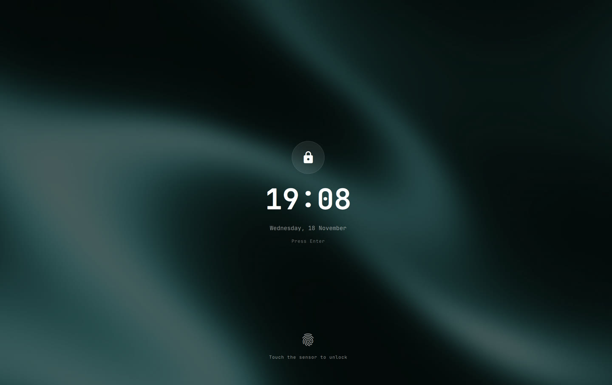
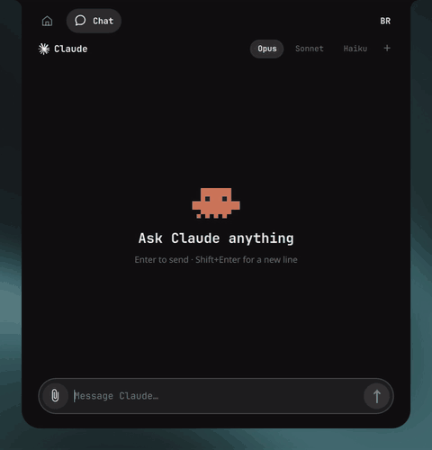
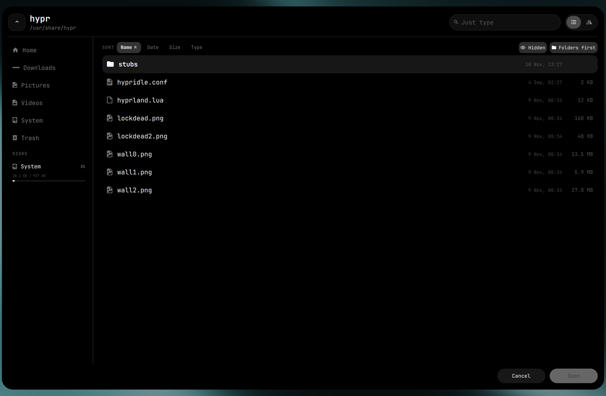
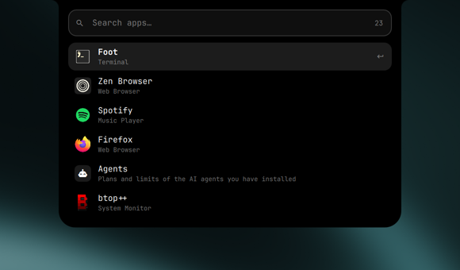

<div align="center">

# panacea-config

**My layer on top of [Panacea Shell](https://github.com/EnsixD/Panacea)**


[Screenshots](#screenshots) · [What changes](#what-changes) · [Fresh install](#from-a-fresh-arch-install) · [How patches survive updates](#how-patches-survive-updates)

</div>

<div align="center">


</div>

Panacea keeps a handful of folders untouched across updates:
`hypr/custom/`, `fish/custom/`, `foot/custom.ini` and `panacea/scripts/custom/`.
Everything here lives in those folders. A few Panacea files are patched in place:
the lock screen, the vault script and the file manager (for the island file picker). Their patchers are idempotent,
all-or-nothing, and re-run themselves whenever an update replaces the file.

## Screenshots

### Lock screen

A bare fingerprint glyph at the bottom: just touch the sensor at any time. After a restart it asks for your password once, which also unlocks the keyring, then it's fingerprint only. It pulses when ready, shakes on a miss, and the unlock fades into the desktop.



### Claude in the island

`Super+C` opens a single Claude tab, cursor in the message box: the Claude
logo, model pills, a little orange pixel Claude on the empty chat, live steps
while it works, and approval cards right in the conversation. It runs through
[panacea-claude-bridge](https://github.com/aphesist/panacea-claude-bridge) on a
Claude subscription.

<p>


</p>

### One file picker, inside the island

The chat's paperclip, and Open/Save dialogs from every app (Zen, Claude
desktop, Electron and GTK apps, via an xdg-desktop-portal backend), morph the
island into its own file manager in picker mode, instead of a white GTK
window tiled behind it. If Panacea isn't running, apps fall back to the GTK
dialog on their own.



### Launcher and calendar

<p>


</p>

## What changes

| Area | Change | Where |
|---|---|---|
| **Lock screen** | Fingerprint unlock at any time, with no password first. A bare fingerprint glyph shows the state: pulses when ready, shakes on a miss, grows on success, dims when the reader is unavailable. A miss retries after 1.5 s | `hypr/custom/bin/lock-patch.py` |
| | Unlock fades into the desktop instead of cutting | `lock-patch.py` + `session_lock_xray` |
| | **Password once per boot**, like macOS after a restart: while the keyring is still locked, the lock screen asks for the password (which also unlocks the keyring through PAM) instead of the fingerprint. Every later unlock is fingerprint, and the keyring's white password prompt never appears | `lock-patch.py` |
| | Locked from the first frame: wallpaper and island are held back until the lock is confirmed, with a black `swaylock` fallback if it isn't up in 4 s | `autostart.lua`, `bin/after-lock` |
| | One lock entry point for startup, idle and lid; `flock` stops two lock clients from starting | `bin/panacea-lock` |
| **Idle** | On battery: lock at 5 min, screen off at 5.5, suspend at 15. Plugged in: lock at 10, screen off at 11 | `hypridle.conf`, `bin/idle-action` |
| **Vault** | Panacea's password manager becomes a front-end for **Proton Pass**: it shows logins from every vault, new and edited entries go back to Proton, and a delete only hides the entry. Offline, it falls back to the encrypted local copy | `panacea/scripts/custom/vault-proton.py`, `bin/vault-patch.py` |
| **Desktop** | Hides hyprpaper's splash quote ("Configration"…): hyprpaper 0.8.5 ignores `splash = false`, so set `splash_opacity = 0` instead | `bin/hyprpaper-nosplash` + `.path` unit |
| | **The wallpaper always comes back.** hyprpaper runs as its own service that restarts itself, so restarting or crashing the Panacea shell no longer leaves the desktop without a wallpaper (it used to be the shell's child) | `panacea-wallpaper.service`, `bin/after-lock` |
| | Softer, slower island motion, closer to macOS: 440 ms, 18 % overshoot | `settings.overrides.json` |
| | Screenshot on **PrtSc** | `settings.overrides.json` |
| | Island chat on **Super+C** (Panacea has no shortcut for it) | `keybindings.lua` |
| | Voice dictation on **Right Ctrl** instead of AltGr, which Brazilian ABNT2 needs for `?` `/` `°` | `settings.overrides.json` |
| | Window corners 16 px with the same squircle curve as the island | `general.lua` |
| | Touchpad right-click by pressing the bottom-right corner (as well as a two-finger tap), instead of Panacea's two-finger-press-only *clickfinger* | `general.lua` |
| | Spotify opens as a normal window (Panacea sends it to the hidden scratchpad) | `windowrules.lua` |
| **File picker** | One picker, inside the island. Every app's Open/Save dialog (browsers, Electron apps, GTK apps) and the chat's paperclip morph the island into its own file manager in picker mode, with Cancel/Open, a filename box for Save and "Use this folder" for folder picks. Before, apps got a white GTK dialog and the paperclip opened a window that Hyprland tiled behind the island. Falls back to the GTK dialog if Panacea can't answer | `bin/panacea-portal.py`, `bin/portal-patch.py`, `portal/` |
| **Spotify** | A Spicetify theme in Panacea's *Nothing* palette: pure black, white, one red; JetBrains Mono; rounded flat panels | `spicetify/Themes/Panacea` |
| | Runs natively on Wayland, so it follows the display scale (under XWayland with `force_zero_scaling` it was drawn at 1×, tiny); Vesktop (Discord) too | `spotify/spotify-flags.conf`, `electron/vesktop-flags.conf` |
| **Claude desktop** | Uses GNOME Keyring for its sign-in (Electron doesn't recognise Hyprland and fell back to "no keyring", so you had to sign in every launch) | `electron/claude-desktop-flags.conf` |
| | **Panacea theme** for the whole Claude desktop app, Chat included: pure black, white text, red as the only accent, every colour token set so nothing falls back to the stock blue/violet. Uses [claude-desktop-extra](https://github.com/patrickjaja/claude-desktop-extra) (the official app plus community patches; its build pulls Anthropic's signed `.deb`). With the official app, a Claude Code mod themes the Code tab instead | `claude-desktop/claude-desktop-extra.jsonc`, `claude-desktop/panacea-look` |
| **Zen Browser** | Web-content corners at 16 px instead of ~5, matching Hyprland's window rounding (`--zen-webview-border-radius`) | `zen/userChrome.css` |
| **Discord** | Vesktop made tiling-friendly: no minimum window size (Discord's 940 px didn't fit a half tile and got cut off), and none of Discord's own window buttons (close with Super+Q, like everything else) | `electron/vesktop-quickCss.css`, `install.sh` |
| **Display** | Internal 2880×1800 OLED at 120 Hz, scale 1.6. Change it for your panel | `monitors.lua` |
| **Terminal** | foot at size 11 to suit the 1.6 scale | `foot/custom.ini` |

The island chat → Claude integration is its own repo:
[panacea-claude-bridge](https://github.com/aphesist/panacea-claude-bridge).

## From a fresh Arch install

`setup.sh` rebuilds this whole machine on the **latest** versions: upstream
Panacea, then all four of my repos on top of it.

```sh
sudo pacman -S --needed git
git clone https://github.com/aphesist/panacea-config ~/src/panacea-config
bash ~/src/panacea-config/setup.sh
```

| Step | What it does |
|---|---|
| `repos` | Clones or updates `~/Panacea` from [EnsixD/Panacea](https://github.com/EnsixD/Panacea) and my repos into `~/src` |
| `panacea` | Panacea's own installer (packages, yay, configs, SDDM and GRUB themes) |
| `apps` | [arch-setup](https://github.com/aphesist/arch-setup) `apps/`: Zen, Spotify + Spicetify, Zed, Claude desktop, Figma, and the full dev toolchain |
| `nvidia` `camera` `fingerprint` | [galaxy-book3-ultra-linux](https://github.com/aphesist/galaxy-book3-ultra-linux). **Only on a Galaxy Book3 Ultra** (detected from DMI). The webcam driver is pinned to the reviewed commit |
| `config` | This repo's `install.sh` |
| `proton` | Proton Pass CLI and the browser login, for the vault sync |
| `claude` | Claude Code and the island chat bridge |
| `boot` → reboot → `autologin` | Silent boot, plus an *autologin test* GRUB entry. After you've tried the test entry, re-run the script to make autologin the default |

- **It asks before every step.** Answer `y`, `n` or `q`, or pass `--yes` to skip the questions.
- **It's resumable.** Progress is kept in `~/.local/state/panacea-setup`. `--list` shows it, and `--from <step>` redoes a step.
- **It never runs as root.** Root work goes through each repo's own scripts, run with `sudo`, and each script checks its own result.

## Install (Panacea already installed)

Install Panacea first, then:

```sh
git clone https://github.com/aphesist/panacea-config && cd panacea-config
bash install.sh
```

The installer backs up every file it replaces to
`~/.local/state/panacea-config/backup-<time>/`. It merges
`settings.overrides.json` into `~/.config/panacea/settings.json` rather than
overwriting it, then enables the user units and patches the lock screen.

**Optional pieces** each need one extra step:

| For | Do |
|---|---|
| Fingerprint on the lock screen | a working reader and the PAM file from [galaxy-book3-ultra-linux](https://github.com/aphesist/galaxy-book3-ultra-linux) → `fingerprint/2-lock-screen-pam.sh` |
| Proton Pass in the vault | `yay -S proton-pass-cli-bin`, then `pass-cli login` (the session key goes to GNOME Keyring, so it survives reboots) |
| Spotify theme | `yay -S spotify spicetify-cli`, `sudo chmod a+wr /opt/spotify /opt/spotify/Apps -R`, open Spotify once, then re-run `install.sh` |

## How patches survive updates

```
Panacea update replaces lock.qml / vault.sh / shell.qml
        │
        ├─ lock.qml   → bin/panacea-lock re-runs lock-patch.py before every lock
        ├─ vault.sh   → panacea-vault-patch.path notices the change → vault-patch.py
        └─ shell.qml, FilesView.qml → panacea-portal-patch.path → portal-patch.py
```

Each patcher searches for exact anchors in Panacea's code. If an update moved
them, the patcher **changes nothing** and Panacea's stock file keeps working.
You lose the extra, never the lock screen. `lock-patch.py` keeps
`lock.qml.pristine`, so a newer patch version upgrades cleanly.

### The vault, precisely

- **Unlock:** Panacea checks your password as before (PAM + its encrypted file). Then it lists your Proton Pass logins (`pass-cli item list --show-secrets`), minus the ones you hid.
- **Add:** the new entry is created in the *Personal* vault, with the password sent on stdin.
- **Edit:** only the changed fields go to `pass-cli item update`. That command takes values as arguments, so an edited password is briefly visible in your own process list.
- **Delete:** the entry is hidden in Panacea only. `pass-cli` can only delete permanently, so real deletion stays in the Proton apps, which have a trash.
- **Unencrypted on disk:** only item IDs (`~/.local/share/panacea/proton-*.json`). No secrets.

## Credits

[Panacea Shell](https://github.com/EnsixD/Panacea) by EnsixD (MIT). The patches
quote small parts of its QML in order to find their place.
[Proton Pass CLI](https://github.com/protonpass/pass-cli) by Proton AG (GPL-3.0),
used as an external program.
